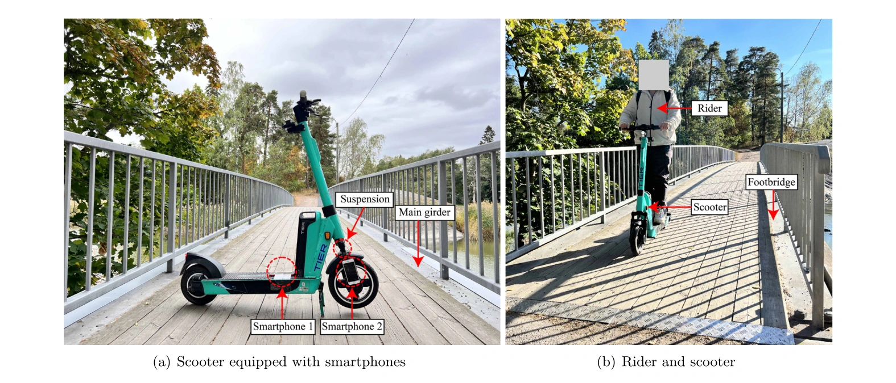

::: {.home-hero}
::: {.hero-copy}
[Intelligent Monitoring of Infrastructures]{.eyebrow}

# Zhenkun Li

[Postdoctoral Researcher]{.hero-role}

[Department of Wind and Energy Systems](https://wind.dtu.dk/en)  
[Technical University of Denmark](https://www.dtu.dk/english), Denmark

I study how measurements and computational models can reveal the condition of structures. My research brings together **structural dynamics, machine learning, and intelligent sensing** for infrastructure assessment.

At DTU, my current work focuses on structural health monitoring, digital twins, computer vision, and predictive maintenance for wind turbines. My wider research spans drive-by bridge monitoring, damage identification, and Bayesian inference.

::: {.hero-actions}
[Explore my research](research/index.qmd){.button-primary}
[Download CV ↓](papers/updated_CV.pdf){.button-secondary}
:::

::: {.profile-links aria-label="Academic profiles and contact"}
[Email](mailto:zhelia@dtu.dk) · [Google Scholar](https://scholar.google.com/citations?user=PrGJZLIAAAAJ&hl=en) · [ORCID](https://orcid.org/0000-0002-1444-6017) · [GitHub](https://github.com/ZhenkunLi) · [LinkedIn](https://www.linkedin.com/in/zhenkun-li/)
:::
:::
::: {.hero-portrait}
{width=340 height=340 fig-alt="Portrait of Zhenkun Li"}

[Roskilde, Denmark]{.portrait-caption}
:::
:::

::: {.home-research}
::: {.section-heading}
## Research at a glance

[All research themes →](research/index.qmd)
:::

::: {.research-overview}
::: {.overview-image}
{width=1575 height=675 fig-alt="An instrumented scooter and rider on a footbridge during field testing."}

[From instrumented vehicles to everyday moving sensors. Field test from Li et al., *Automation in Construction* (2024), Fig. 11.](https://doi.org/10.1016/j.autcon.2024.105587){.image-credit}
:::
::: {.theme-list}
1. [[Mobile sensing & bridge monitoring]{.theme-name} [Vehicles, scooters, pedestrians, and robots as moving sensors for bridges.]{.theme-desc}](research/index.qmd#mobile-sensing)
2. [[Intelligent damage diagnosis]{.theme-name} [Learning-based methods that link measured vibrations to structural damage.]{.theme-desc}](research/index.qmd#intelligent-diagnostics)
3. [[Vision & field monitoring]{.theme-name} [Non-contact displacement measurement and monitoring in real conditions.]{.theme-desc}](research/index.qmd#vision-field-monitoring)
4. [[Structural identification & Bayesian methods]{.theme-name} [Mechanical models combined with measurements and explicit uncertainty.]{.theme-desc}](research/index.qmd#structural-identification)
5. [[Materials informatics]{.theme-name} [Explainable machine learning for engineering material properties.]{.theme-desc}](research/index.qmd#materials-informatics)
:::
:::
:::

::: {.home-bottom}
::: {.selected-reading}
## Selected reading

::: {.reading-item}
[A comprehensive review of indirect bridge health monitoring](publications/index.qmd#pub-mssp-review)

[**Z. Li**, W. Lin, C.-W. Kim, M. P. Limongelli, E. Chatzi]{.reading-authors}

*Mechanical Systems and Signal Processing* · 2026
:::

::: {.reading-item}
[Pedestrian-sensed indirect footbridge frequency identification](publications/index.qmd#pub-jsv-zhenkun2026)

[**Z. Li**, S. Ereiz, E. Ozer, A. Malekjafarian, M. P. Limongelli]{.reading-authors}

*Journal of Sound and Vibration* · 2026
:::

::: {.reading-item}
[Footbridge damage detection using smartphone-recorded responses of micromobility and convolutional neural networks](publications/index.qmd#pub-aic-scooter)

[**Z. Li**, Y. Lan, W. Lin]{.reading-authors}

*Automation in Construction* · 2024
:::

[All publications →](publications/index.qmd)
:::
::: {.recent-updates}
## Recent updates

::: {.update-item}
[1 October 2026]{.update-date}

Joined DTU Wind and Energy Systems as a Postdoctoral Researcher, working on wind turbine operations and maintenance.
:::

::: {.update-item}
[July 2026]{.update-date}

Supervised the team receiving the Audience Prize at the EWSHM Young Researcher Challenge.
:::

::: {.update-item}
[29 January 2026]{.update-date}

Our [review of indirect bridge health monitoring](https://doi.org/10.1016/j.ymssp.2026.113918) was published in *Mechanical Systems and Signal Processing*.
:::

[More news →](news/index.qmd)
:::
:::

::: {.collaboration-note}
Interested in structural monitoring, sensing, or data-driven assessment? [Get in touch](mailto:zhelia@dtu.dk).
:::
