::: {.page-intro}
My work connects structural mechanics with sensing and data analysis. The themes below bring together research on bridges, civil infrastructure, and engineering materials, from numerical models to laboratory and field measurements.
:::

::: {.theme-jump aria-label="Research themes"}
[Mobile sensing](#mobile-sensing) · [Intelligent diagnosis](#intelligent-diagnostics) · [Vision & field monitoring](#vision-field-monitoring) · [Structural identification](#structural-identification) · [Materials informatics](#materials-informatics)
:::

:::: {.research-section #mobile-sensing}
::: {.research-copy}
[01 · Sensing beyond the structure]{.eyebrow}

## Mobile sensing & bridge monitoring

Can a passing vehicle reveal the condition of a bridge? I investigate indirect monitoring through vehicle–bridge interaction, using instrumented vehicles, shared scooters, pedestrians, and robots as moving sensing platforms.

This work studies frequency and mode-shape identification, contact-point responses, crowdsensing, and the effects of vehicle dynamics, road roughness, and operating conditions.

:::
::: {.research-studies}
**Representative studies**

- [A comprehensive review of indirect bridge health monitoring](../publications/index.qmd#pub-mssp-review) · MSSP, 2026
- [Pedestrian-sensed footbridge frequency identification](../publications/index.qmd#pub-jsv-zhenkun2026) · JSV, 2026
- [Contact-point responses of shared scooters](../publications/index.qmd#pub-jbe-scooter) · JBE, 2024
:::
::: {.research-visual}
<figure>
<a href="../img/research/mobile-sensing-vehicle-model.webp" target="_blank" rel="noopener" aria-label="View full-size figure: 3D vehicle–bridge model">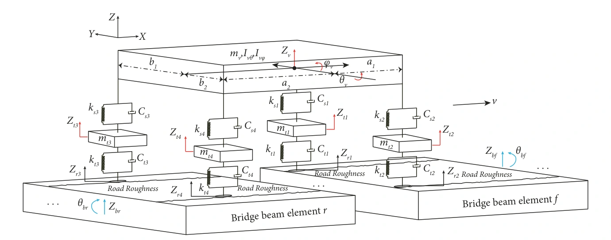</a>
<figcaption>3D vehicle–bridge modelLi et al., <a href="https://doi.org/10.1155/2023/3924349"><em>Structural Control and Health Monitoring</em> (2023), Fig. 1</a>.<a href="../img/research/mobile-sensing-vehicle-model.webp" target="_blank" rel="noopener">Full size ↗</a> · <a href="../papers/3D-vehicle.pdf#page=4">PDF p. 4</a></figcaption>
</figure>
<figure>
<a href="../img/research/mobile-sensing.webp" target="_blank" rel="noopener" aria-label="View full-size figure: Smartphone field tests">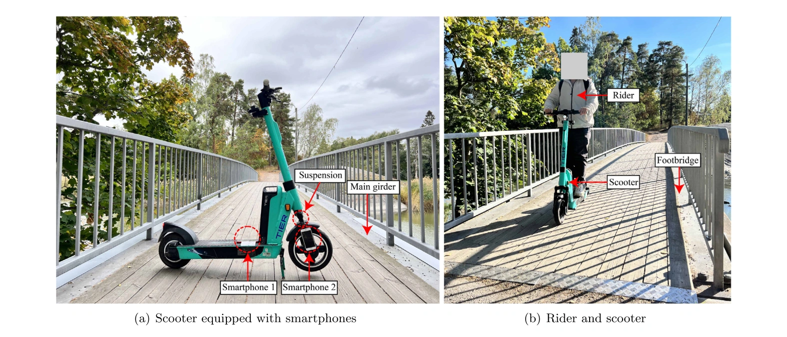</a>
<figcaption>Smartphone field testsLi et al., <a href="https://doi.org/10.1016/j.autcon.2024.105587"><em>Automation in Construction</em> (2024), Fig. 11</a>.<a href="../img/research/mobile-sensing.webp" target="_blank" rel="noopener">Full size ↗</a> · <a href="../papers/1-s2.0-S0926580524003236-main.pdf#page=9">PDF p. 9</a></figcaption>
</figure>
<figure>
<a href="../img/research/mobile-sensing-pedestrian.webp" target="_blank" rel="noopener" aria-label="View full-size figure: Pedestrian sensing models">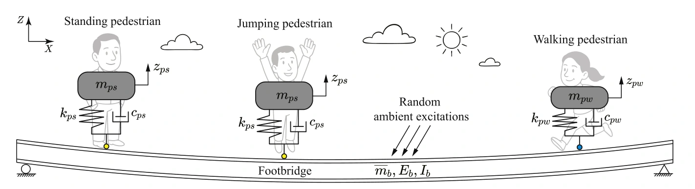</a>
<figcaption>Pedestrian sensing modelsLi et al., <a href="https://doi.org/10.1016/j.jsv.2026.119904"><em>Journal of Sound and Vibration</em> (2026), Fig. 1</a>.<a href="../img/research/mobile-sensing-pedestrian.webp" target="_blank" rel="noopener">Full size ↗</a> · <a href="../papers/1-s2.0-S0022460X2600266X-main.pdf#page=3">PDF p. 3</a></figcaption>
</figure>
:::
::::

:::: {.research-section #intelligent-diagnostics}
::: {.research-copy}
[02 · From response to diagnosis]{.eyebrow}

## Intelligent damage diagnosis

I develop and investigate learning-based methods that connect measured vibration responses to structural damage. These include convolutional neural networks, auto-encoders, signal-processing features, and physics-guided diagnosis.

Related work examines synthetic training data, model interpretability, and the vulnerability of learning-based monitoring systems. Numerical simulations and experimental studies help establish where these methods can be useful.

:::
::: {.research-studies}
**Representative studies**

- [Real-time drive-by damage detection using a deep auto-encoder](../publications/index.qmd#pub-real-time) · Structures, 2023
- [Physics-guided diagnosis using raw vehicle accelerations](../publications/index.qmd#pub-physics-informed-yifu) · MSSP, 2024
- [Smartphone-recorded micromobility responses and CNNs](../publications/index.qmd#pub-aic-scooter) · Automation in Construction, 2024
:::
::: {.research-visual}
<figure>
<a href="../img/research/intelligent-diagnostics.webp" target="_blank" rel="noopener" aria-label="View full-size figure: Learning-based diagnosis">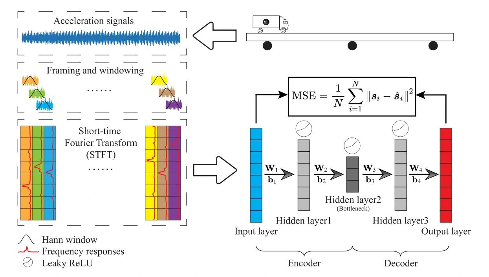</a>
<figcaption>Learning-based diagnosisLi et al., <a href="https://doi.org/10.1016/j.istruc.2022.11.094"><em>Structures</em> (2023), Fig. 1</a>.<a href="../img/research/intelligent-diagnostics.webp" target="_blank" rel="noopener">Full size ↗</a> · <a href="../papers/Real-time.pdf#page=3">PDF p. 3</a></figcaption>
</figure>
<figure>
<a href="../img/research/intelligent-diagnostics-lab.webp" target="_blank" rel="noopener" aria-label="View full-size figure: Laboratory bridge setup">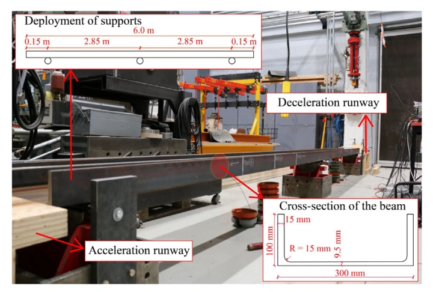</a>
<figcaption>Laboratory bridge setupLi et al., <a href="https://doi.org/10.1016/j.istruc.2022.11.094"><em>Structures</em> (2023), Fig. 2</a>.<a href="../img/research/intelligent-diagnostics-lab.webp" target="_blank" rel="noopener">Full size ↗</a> · <a href="../papers/Real-time.pdf#page=4">PDF p. 4</a></figcaption>
</figure>
<figure>
<a href="../img/research/intelligent-diagnostics-results.webp" target="_blank" rel="noopener" aria-label="View full-size figure: Damage-index distributions">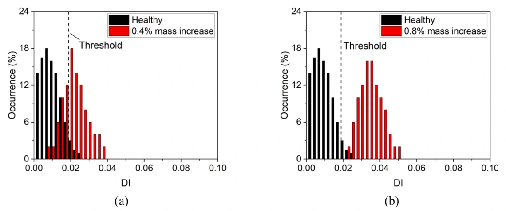</a>
<figcaption>Damage-index distributionsLan et al., <a href="https://doi.org/10.1016/j.ymssp.2023.110899"><em>Mechanical Systems and Signal Processing</em> (2024), Fig. 20</a>.<a href="../img/research/intelligent-diagnostics-results.webp" target="_blank" rel="noopener">Full size ↗</a> · <a href="../papers/1-s2.0-S0888327023008075-main.pdf#page=16">PDF p. 16</a></figcaption>
</figure>
:::
::::

:::: {.research-section #vision-field-monitoring}
::: {.research-copy}
[03 · Measuring in real conditions]{.eyebrow}

## Vision & field monitoring {#vision-research}

Cameras offer a non-contact way to measure structural displacement. My work in this area investigates phase-based measurement, Gabor-wavelet parameter selection, and robustness under changing illumination.

I also study how environmental conditions influence monitoring data, including temperature effects on strain retrieval in a field-monitored footbridge.

:::
::: {.research-studies}
**Representative studies**

- [Phase-based displacement under illumination variation](../publications/index.qmd#pub-measurement-2026-sida) · Measurement, 2026
- [Center-frequency optimization for Gabor wavelets](../publications/index.qmd#pub-cacaie-2026-sida) · CACAIE, 2026
- [Temperature effects on strain retrieval: a field study](../publications/index.qmd#pub-structures-zhenkun-rolands) · Structures, 2026
:::
::: {.research-visual}
<figure>
<a href="../img/research/vision-field-monitoring.webp" target="_blank" rel="noopener" aria-label="View full-size figure: Vision measurement experiment">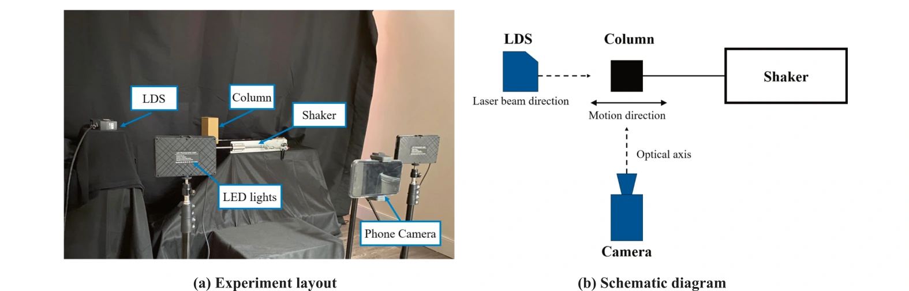</a>
<figcaption>Vision measurement experimentAi &amp; Li, <a href="https://doi.org/10.1016/j.measurement.2026.122441"><em>Measurement</em> (2026), Fig. 3</a>.<a href="../img/research/vision-field-monitoring.webp" target="_blank" rel="noopener">Full size ↗</a> · <a href="../papers/1-s2.0-S0263224126021500-main.pdf#page=4">PDF p. 4</a></figcaption>
</figure>
<figure>
<a href="../img/research/vision-field-monitoring-results.webp" target="_blank" rel="noopener" aria-label="View full-size figure: Displacement measurement comparison">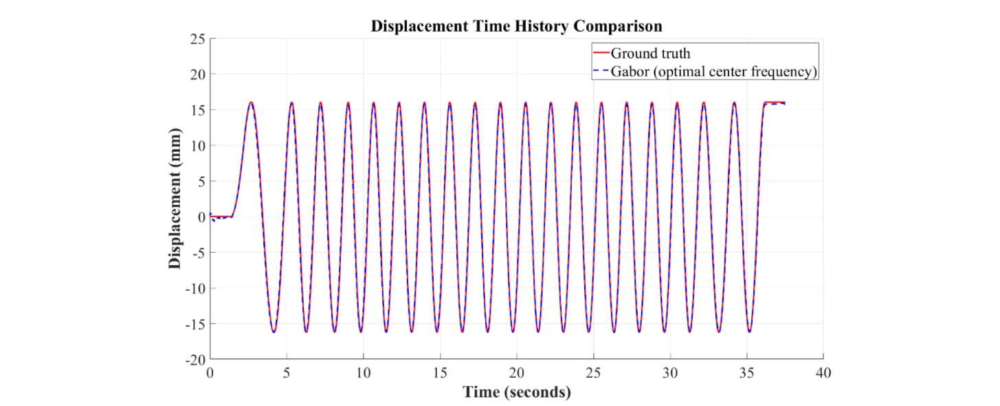</a>
<figcaption>Displacement measurement comparisonAi &amp; Li, <a href="https://doi.org/10.1016/j.cacaie.2026.100205"><em>Computer-Aided Civil and Infrastructure Engineering</em> (2026), Fig. 12</a>.<a href="../img/research/vision-field-monitoring-results.webp" target="_blank" rel="noopener">Full size ↗</a> · <a href="../papers/CACAIE-2026-Sida.pdf#page=10">PDF p. 10</a></figcaption>
</figure>
<figure>
<a href="../img/research/vision-field-monitoring-field.webp" target="_blank" rel="noopener" aria-label="View full-size figure: Field monitoring of a footbridge">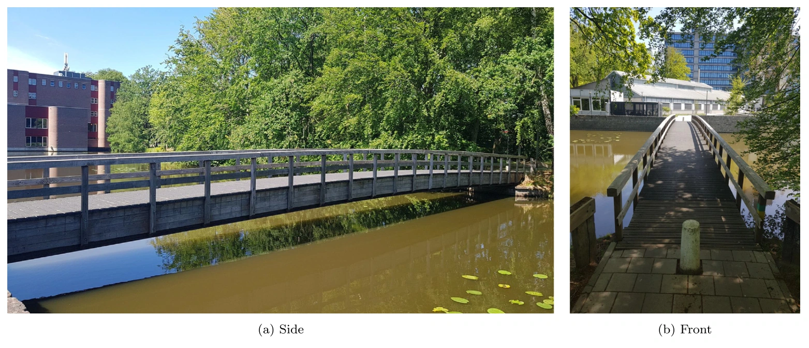</a>
<figcaption>Field monitoring of a footbridgeLi &amp; Kromanis, <a href="https://doi.org/10.1016/j.istruc.2026.111949"><em>Structures</em> (2026), Fig. 2</a>.<a href="../img/research/vision-field-monitoring-field.webp" target="_blank" rel="noopener">Full size ↗</a> · <a href="../papers/1-s2.0-S2352012426008982-main.pdf#page=4">PDF p. 4</a></figcaption>
</figure>
:::
::::

:::: {.research-section #structural-identification}
::: {.research-copy}
[04 · Mechanics and uncertainty]{.eyebrow}

## Structural identification & Bayesian methods

My research in structural identification uses virtual mass modification, modal information, data fusion, and Bayesian inference to infer structural condition. This combines mechanical models with measured responses and explicit treatment of uncertainty.

Related studies address bridge dynamics, cable interactions, influence-line identification, and structural safety under collision.

:::
::: {.research-studies}
**Representative studies**

- [Virtual masses and Bayesian damage identification](../publications/index.qmd#pub-structural) · SMO, 2022
- [Local mass addition and data fusion](../publications/index.qmd#pub-local) · IJSSD, 2020
- [Optimal placement of virtual masses](../publications/index.qmd#pub-optimal) · Sensors, 2019
:::
::: {.research-visual}
<figure>
<a href="../img/research/structural-identification.webp" target="_blank" rel="noopener" aria-label="View full-size figure: Structural and finite-element models">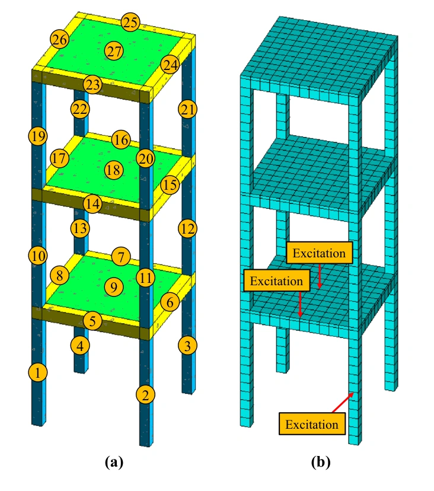</a>
<figcaption>Structural and finite-element modelsLi et al., <a href="https://doi.org/10.1007/s00158-021-03156-y"><em>Structural and Multidisciplinary Optimization</em> (2022), Fig. 16</a>.<a href="../img/research/structural-identification.webp" target="_blank" rel="noopener">Full size ↗</a> · <a href="../papers/Structural.pdf#page=14">PDF p. 14</a></figcaption>
</figure>
<figure>
<a href="../img/research/structural-identification-experiment.webp" target="_blank" rel="noopener" aria-label="View full-size figure: Experimental frame and sensors">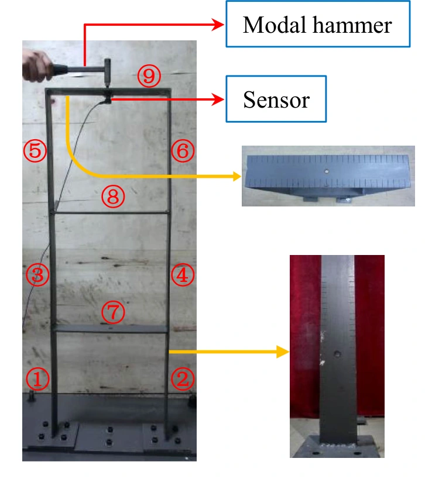</a>
<figcaption>Experimental frame and sensorsLi et al., <a href="https://doi.org/10.1007/s00158-021-03156-y"><em>Structural and Multidisciplinary Optimization</em> (2022), Fig. 18</a>.<a href="../img/research/structural-identification-experiment.webp" target="_blank" rel="noopener">Full size ↗</a> · <a href="../papers/Structural.pdf#page=15">PDF p. 15</a></figcaption>
</figure>
<figure>
<a href="../img/research/structural-identification-results.webp" target="_blank" rel="noopener" aria-label="View full-size figure: Damage identification results">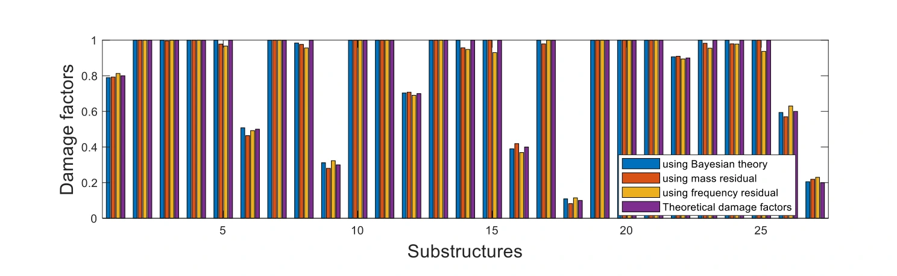</a>
<figcaption>Damage identification resultsLi et al., <a href="https://doi.org/10.1007/s00158-021-03156-y"><em>Structural and Multidisciplinary Optimization</em> (2022), Fig. 17</a>.<a href="../img/research/structural-identification-results.webp" target="_blank" rel="noopener">Full size ↗</a> · <a href="../papers/Structural.pdf#page=14">PDF p. 14</a></figcaption>
</figure>
:::
::::

:::: {.research-section #materials-informatics}
::: {.research-copy}
[05 · Learning material behaviour]{.eyebrow}

## Materials informatics {#materials-research}

In collaborative work, I apply explainable machine learning to engineering material properties. The aim is to connect prediction with an understanding of influential parameters and uncertainty.

Applications include multiscale thermal-conductivity modelling of polymer nanocomposites and prediction of asphalt rheological properties for paving and maintenance.

:::
::: {.research-studies}
**Representative studies**

- [Multiscale thermal-conductivity modelling with uncertainty quantification](../publications/index.qmd#pub-comstruct-liu) · Composite Structures, 2025
- [Explainable prediction of asphalt rheological properties](../publications/index.qmd#pub-fuel-fan) · Fuel, 2025
:::
::: {.research-visual}
<figure>
<a href="../img/research/materials-informatics-multiscale.webp" target="_blank" rel="noopener" aria-label="View full-size figure: Multiscale material modelling">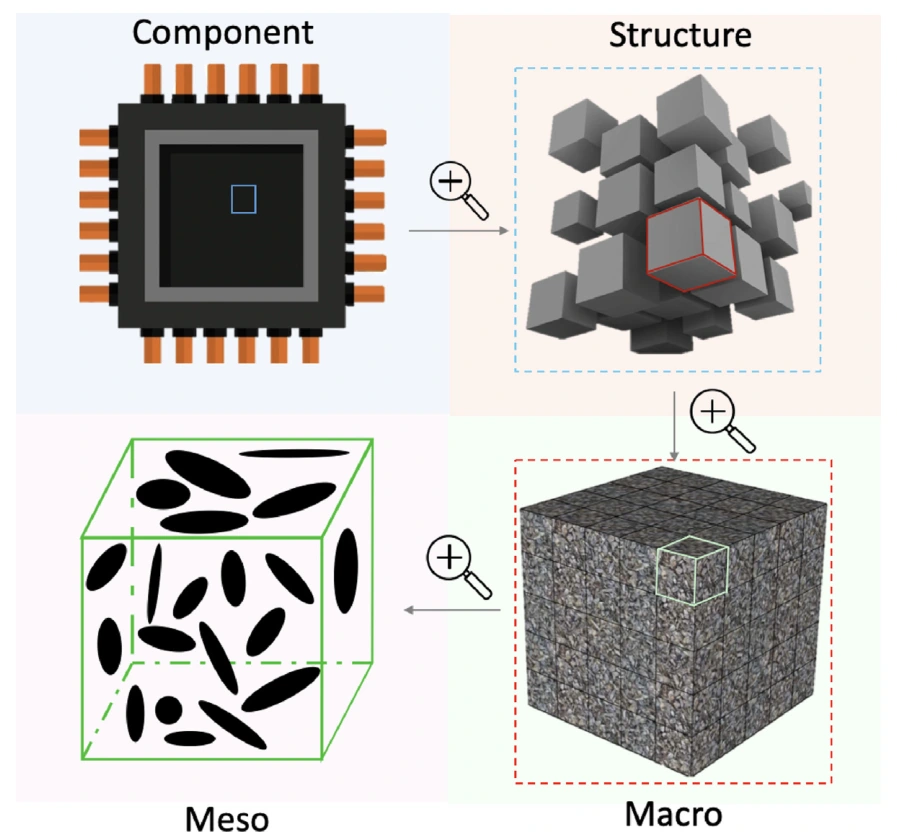</a>
<figcaption>Multiscale material modellingLiu et al., <a href="https://doi.org/10.1016/j.compstruct.2025.119292"><em>Composite Structures</em> (2025), Fig. 1</a>.<a href="../img/research/materials-informatics-multiscale.webp" target="_blank" rel="noopener">Full size ↗</a> · <a href="../papers/1-s2.0-S026382232500457X-main.pdf#page=4">PDF p. 4</a></figcaption>
</figure>
<figure>
<a href="../img/research/materials-informatics.webp" target="_blank" rel="noopener" aria-label="View full-size figure: Modelling and learning framework">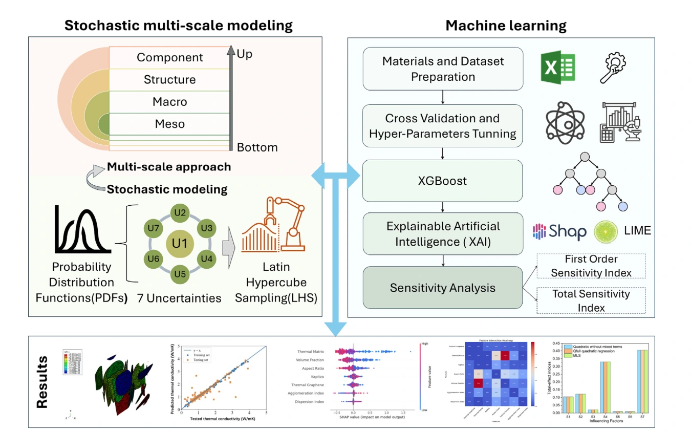</a>
<figcaption>Modelling and learning frameworkLiu et al., <a href="https://doi.org/10.1016/j.compstruct.2025.119292"><em>Composite Structures</em> (2025), Fig. 2</a>.<a href="../img/research/materials-informatics.webp" target="_blank" rel="noopener">Full size ↗</a> · <a href="../papers/1-s2.0-S026382232500457X-main.pdf#page=4">PDF p. 4</a></figcaption>
</figure>
<figure>
<a href="../img/research/materials-informatics-explainability.webp" target="_blank" rel="noopener" aria-label="View full-size figure: Explaining material predictions">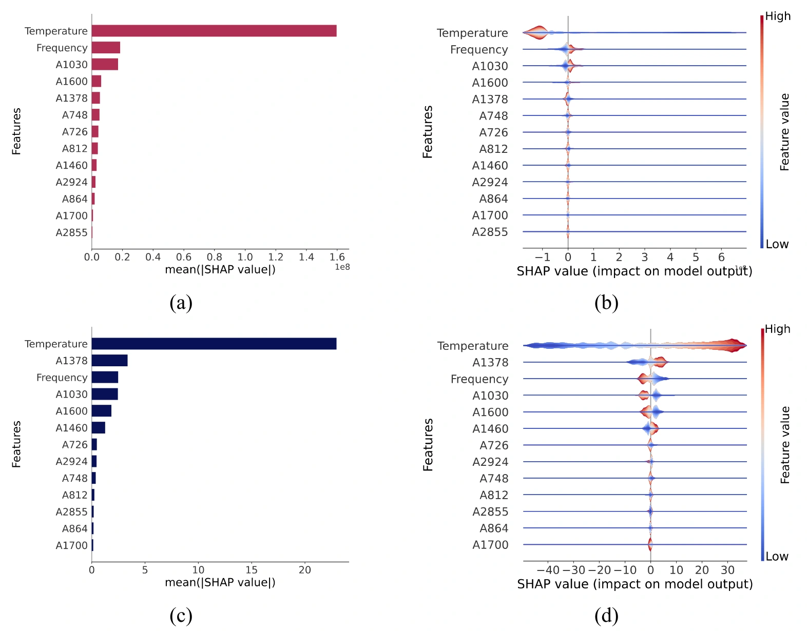</a>
<figcaption>Explaining material predictionsZhang et al., <a href="https://doi.org/10.1016/j.fuel.2025.135319"><em>Fuel</em> (2025), Fig. 11</a>.<a href="../img/research/materials-informatics-explainability.webp" target="_blank" rel="noopener">Full size ↗</a> · <a href="../papers/1-s2.0-S0016236125010440-main.pdf#page=12">PDF p. 12</a></figcaption>
</figure>
:::
::::

::: {.current-focus}
## Current focus at DTU

At DTU Wind and Energy Systems, I work on **structural health monitoring, digital twins, computer vision, operations, and predictive maintenance for wind turbines**. This builds on my experience in structural dynamics and infrastructure monitoring.

[Discuss a collaboration →](mailto:zhelia@dtu.dk)
:::

## Research projects

| Period | Project and role |
|:--|:--|
| Dec 2025–Sep 2026 | **POLIMI Excellence Postdoctoral Fellowship** — Development and Value Quantification of Low Carbon Footprint Structural Health Monitoring Systems for Bridge Integrity Management. Principal Investigator. €109,600. Concluded upon departure from Politecnico di Milano; final report submitted. |
| Sep 2024–Aug 2026 | **SHM of Bridges** — Finnish Transport Infrastructure Agency, City of Espoo, and City of Helsinki; recipients Weiwei Lin and VTT Oy. Key Researcher. €160,000. Completed. |
| Sep 2021–Aug 2024 | **Automated Inspection System for Bridges using Drive-By Method and Deep Learning** — Jane and Aatos Erkko Foundation, grant 210018; recipient Weiwei Lin. Key Researcher. €346,000. Completed. |
| Jan 2019–Dec 2022 | **Structural damage identification and experiment study of slab track based on adding virtual physical parameters** — NSFC grant 51878118; recipient Jilin Hou. Key Researcher. CNY 680,000. Completed. |

[Browse all publications →](../publications/index.qmd)
